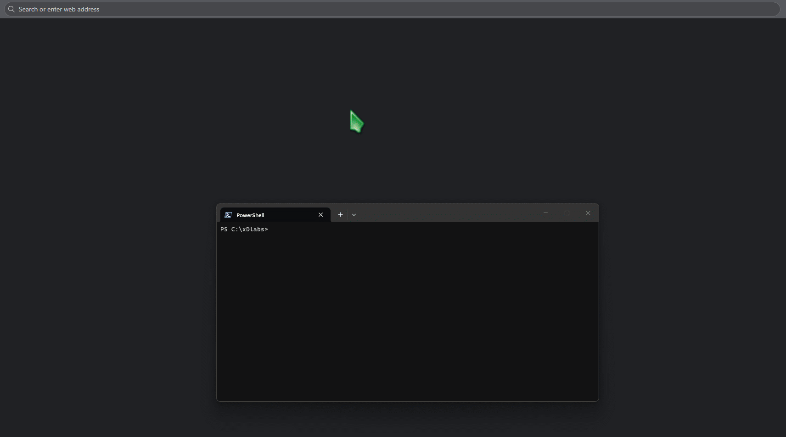

# xDPsApiExplorer


**xDPsApiExplorer** by [xDlabs](https://xdlabs.info) Grzegorz Kulikowski is an interactive, **100% offline** API & Object Graph Explorer for PowerShell and VMware PowerCLI / vSphere Web Services SDK.



## Features

- **100% Offline HTML5 UML Graph**: Zero external CDNs or internet requests. Ideal for isolated/air-gapped vSphere and enterprise environments.
- **2-Object Deep Comparison Mode (`$obj1, $obj2 | Show-ApiContext`)**: Pass two objects of the same type to compare all nested property paths side-by-side (`ShowDifferent`, `Value Differences`, `IncludeEqual`, array count differences, and missing elements).
- **Deep Live + Schema Inspection (`-MaxDepth 1..10`)**: Combines live PowerShell runtime values with `.NET Reflection` so even `$null` properties expose their full class structure and child properties.
- **Embedded Broadcom vSphere SDK Documentation**: Built-in offline documentation for 4,880+ vSphere Web Services SDK types, properties, and methods.
- **Interactive `Where-Object (?{ })` Filter Builder**: Click `?` next to any property to build multi-condition PowerShell filters (`-eq`, `-ne`, `-like`, `-match`, `-gt`, `-lt`) with `-and` / `-or` operators.
- **VMware `ManagedObjectReference` (MoRef) Helpers**: Automatically highlights `MoRef` links (`HostSystem`, `Datastore`, `Folder`, `Network`, etc.) and generates one-click `Get-View -Id ...` commands.
- **Pinned Boxes Dock**: Pin up to 5 boxes to the bottom-left dock to bookmark and jump between distant branches of large object graphs.

## Installation

```powershell
Install-Module -Name xDPsApiExplorer -Scope CurrentUser
```

## Quick Start

```powershell
Import-Module xDPsApiExplorer

# Explore a VMware vSphere VirtualMachine view object:
$vm = Get-View -ViewType VirtualMachine -Filter @{ Name = 'prod-vm-01' }
$vm | Show-ApiContext -MaxDepth 6

# Or use the short alias 'sac':
$vm.ExtensionData | sac -MaxDepth 6

# Explore any standard PowerShell / .NET object:
Get-Process -Id $PID | Show-ApiContext -MaxDepth 3
```

---

## Build & Unit Test Verification

The module is compiled into a single optimized distributable package using **PoshCode `ModuleBuilder`** and verified with **Pester 6.x** unit tests via [`build.ps1`](./build.ps1).

| Metric | Value |
| :--- | :--- |
| **Build Tool** | PoshCode `ModuleBuilder` `v3.2.18` (`Build-Module`) |
| **Code Signing** | `Certum Code Signing 2021 CA` (`CN=xDlabs Grzegorz Kulikowski`, SHA256 + RFC3161 Timestamp) |
| **Test Framework** | `Pester` `v6.2.0` |
| **Module Version** | `1.1.1` |
| **Total Tests** | **20 Passed**, 0 Failed, 0 Skipped |
| **Total Duration** | `3.20s` |

### Unit Test Suite Results (`Tests/xDPsApiExplorer.Tests.ps1`)

| Context | Unit Test Case | Status | Duration |
| :--- | :--- | :---: | :---: |
| **Packaging & Manifest** | Produces a valid compiled module manifest with `LicenseUri` and `ProjectUri` | ✅ Passed | `261ms` |
| **Packaging & Manifest** | Copies `Data/vSphereApiDocs.json`, `README.md`, and `LICENSE` into built module output | ✅ Passed | `14ms` |
| **Packaging & Manifest** | Exports `Show-ApiContext` and convenience aliases `Show-ApiGraph` and `sac` | ✅ Passed | `29ms` |
| **Packaging & Manifest** | Has a valid Authenticode digital signature from `xDlabs Grzegorz Kulikowski` on compiled `.psd1` and `.psm1` | ✅ Passed | `35ms` |
| **Parameter Validation** | Rejects `-MaxDepth 0` (below minimum) | ✅ Passed | `74ms` |
| **Parameter Validation** | Rejects `-MaxDepth 11` (above maximum) | ✅ Passed | `21ms` |
| **Deep Inspection & Engine** | Detects variable name `$myVM` from the pipeline and uses full `.NET` type names | ✅ Passed | `420ms` |
| **Deep Inspection & Engine** | Reflects `.NET` schema even for `$null` properties (`GuestSummary`) with full type name | ✅ Passed | `155ms` |
| **Deep Inspection & Engine** | Unwraps polymorphic arrays without wasting `MaxDepth` and includes inline element previews | ✅ Passed | `136ms` |
| **Deep Inspection & Engine** | Detects VMware `ManagedObjectReference` (`MoRef`) and builds `Get-View` helper command | ✅ Passed | `104ms` |
| **Deep Inspection & Engine** | Collects API methods with full `.NET` parameter and return type signatures | ✅ Passed | `141ms` |
| **Deep Inspection & Engine** | Marks `TruncatedByDepth = true` when complex child objects exceed `MaxDepth` | ✅ Passed | `125ms` |
| **Deep Inspection & Engine** | Safely handles cyclic object references without infinite recursion | ✅ Passed | `144ms` |
| **Deep Inspection & Engine** | Attaches official Broadcom vSphere SDK offline documentation descriptions to types, properties, and methods | ✅ Passed | `134ms` |
| **Deep Inspection & Engine** | Generates a 100% self-contained offline HTML file with `Where-Object (?{ })` filter builder, `Hide Unmatched`, Panel Resizer, Pinned Boxes (`0/5`), and `[Type]` notation | ✅ Passed | `297ms` |
| **Deep Inspection & Engine** | Inspects properties (`Length`) and methods (`Substring`, `Replace`) when a simple type like `[System.String]` is passed as root object | ✅ Passed | `71ms` |
| **Deep Inspection & Engine** | Inspects nested `ConvertFrom-Json` `PSCustomObject` hierarchies and arrays without false cycle detection | ✅ Passed | `74ms` |
| **2-Object Comparison Mode** | Switches to Comparison Mode when 2 objects of the same type are passed and renders `ShowDifferent` and `IncludeEqual` filters | ✅ Passed | `310ms` |
| **2-Object Comparison Mode** | Throws a terminating error when 2 objects of different types are passed | ✅ Passed | `18ms` |
| **2-Object Comparison Mode** | Throws a terminating error when more than 2 objects are passed | ✅ Passed | `12ms` |

<details>
<summary><strong>View Raw Console Output (<code>./build.ps1 -Task Clean, Build, Sign, Test</code>)</strong></summary>

```text
==> [Clean] Removing output directory...
==> [Build] Building xDPsApiExplorer with PoshCode ModuleBuilder...
    Built module: xDPsApiExplorer v1.0.3 -> output\xDPsApiExplorer\1.0.3
==> [Sign] Signing compiled module with xDlabs Code Signing Certificate...
    Signing xDPsApiExplorer.psd1 [Thumbprint: 36B7A51BCAE481C66ACECF4F7CF7BADAEA7D8D81]...
    Verified signature on xDPsApiExplorer.psd1: Valid (CN=xDlabs Grzegorz Kulikowski, O=xDlabs Grzegorz Kulikowski, L=Gdańsk, S=pomorskie, C=PL)
    Signing xDPsApiExplorer.psm1 [Thumbprint: 36B7A51BCAE481C66ACECF4F7CF7BADAEA7D8D81]...
    Verified signature on xDPsApiExplorer.psm1: Valid (CN=xDlabs Grzegorz Kulikowski, O=xDlabs Grzegorz Kulikowski, L=Gdańsk, S=pomorskie, C=PL)
==> [Test] Running Pester 6.x unit tests...
Pester v6.2.0

Running tests from 'Tests\xDPsApiExplorer.Tests.ps1'
Describing xDPsApiExplorer Built Module (PoshCode ModuleBuilder + Native UML Engine)
 Context ModuleBuilder Packaging, Manifest Metadata & Exports
   [+] Produces a valid compiled module manifest with LicenseUri and ProjectUri 271ms
   [+] Copies Data/vSphereApiDocs.json, README.md, and LICENSE into the built module output 15ms
   [+] Exports Show-ApiContext and convenience aliases Show-ApiGraph and sac 30ms
   [+] Has a valid Authenticode digital signature from xDlabs Grzegorz Kulikowski on compiled .psd1 and .psm1 63ms
 Context Parameter Validation (-MaxDepth 1..10)
   [+] Rejects -MaxDepth 0 (below minimum) 62ms
   [+] Rejects -MaxDepth 11 (above maximum) 23ms
 Context Full .NET Type Names, Pipeline Variable Detection & Deep Inspection
   [+] Detects variable name $myVM from the pipeline and uses full .NET type names 428ms
   [+] Reflects .NET schema even for $null properties (GuestSummary) with full type name 115ms
   [+] Unwraps polymorphic arrays without wasting MaxDepth and includes inline element previews 130ms
   [+] Detects VMware ManagedObjectReference (MoRef) and builds Get-View helper command 102ms
   [+] Collects API methods with full .NET parameter and return type signatures 86ms
   [+] Marks TruncatedByDepth = true when complex child objects exceed MaxDepth 80ms
   [+] Safely handles cyclic object references without infinite recursion 102ms
   [+] Attaches official Broadcom vSphere SDK offline documentation descriptions to types, properties, and methods 88ms
   [+] Generates a 100% self-contained offline HTML file with Where-Object (?{ }) filter builder, Hide Unmatched, Panel Resizer, Pinned Boxes (0/5), and [Type] notation 251ms
   [+] Inspects properties (Length) and methods (Substring, Replace) when a simple type like [System.String] is passed as root object 72ms
Tests completed in 3.49s
Tests Passed: 16, Failed: 0, Skipped: 0, Inconclusive: 0, NotRun: 0
    All 16 Pester 6.x unit tests passed!
```

</details>

---

## Author & Links

- **Author / Company**: Grzegorz Kulikowski [xDlabs](https://xdlabs.info)
- **Repository**: [https://github.com/qlikq/xDPsApiExplorer](https://github.com/qlikq/xDPsApiExplorer)
